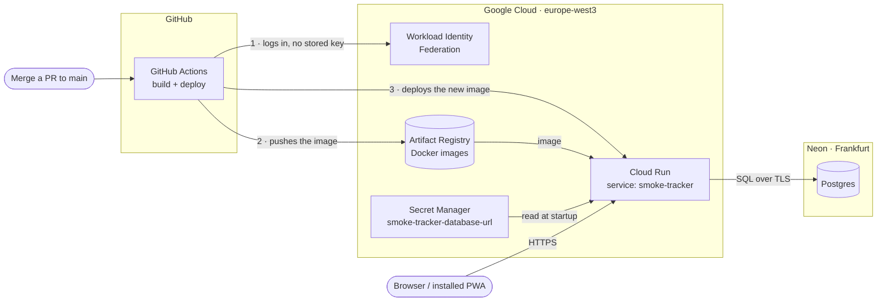

# Smoke Tracker

A small, installable web app (PWA) for logging cigarette smoke that drifts into an apartment
from neighbours. It records how strong the smell is, which rooms it reached, any symptoms, and
PM2.5 readings, and builds a detailed, tamper-evident record over time.

Written in Rust (Axum, Askama, htmx), with SQLite locally and Postgres in production.

> **Status:** early development. See the [roadmap](docs/plans/ROADMAP.md).

## Development

Requirements: [rustup](https://rustup.rs), [gitleaks](https://github.com/gitleaks/gitleaks)
(`brew install gitleaks`), Docker, and sqlx-cli:

```sh
git config core.hooksPath .githooks   # once per clone: blocks commits containing secrets
cargo install sqlx-cli --version 0.9.0 --no-default-features --features sqlite,postgres,rustls,sqlx-toml

# A throwaway local Postgres for the Postgres tests (no password, local only)
docker run -d --name smoke-pg -e POSTGRES_HOST_AUTH_METHOD=trust -p 5432:5432 postgres:17-alpine
export TEST_POSTGRES_URL=postgres://postgres@localhost:5432/postgres

cargo test --workspace         # Postgres tests are skipped when TEST_POSTGRES_URL is unset
scripts/sqlx-prepare.sh        # after changing a query or a migration; commit the .sqlx/ changes
```

Building needs no database: queries are checked against the committed `.sqlx/` metadata.

## Running it

Configuration comes from environment variables only; [`.env.example`](.env.example) lists
every one.

```sh
cp .env.example .env && mkdir -p data
set -a; . ./.env; set +a
cargo run -p smoke-tracker -- create-resident <username>   # prompts for the password
cargo run -p smoke-tracker -- serve                        # http://localhost:8080
cargo run -p smoke-tracker -- verify-audit                 # exits with 1 if the history was altered
```

### Container

Every push to `main` publishes `ghcr.io/locadani/smoke-tracker`: one static binary on a
distroless base, with the database in the `/data` volume.

```sh
docker build -t smoke-tracker .
docker volume create smoke-data
docker run --rm -it -v smoke-data:/data smoke-tracker create-resident <username>
docker run -d -p 8080:8080 -v smoke-data:/data -e APP_BASE_URL=http://localhost:8080 smoke-tracker
```

On **Cloud Run** (the run.app URL or a domain mapping, no load balancer) also set
`CLIENT_IP_HEADER=X-Forwarded-For`. The app's TCP peer there is Google's front end, so
without it every visitor shares one address and the per-address sign-in limit locks
everyone out together. The front end appends the real client as the header's last entry,
which is the one the app trusts. With `RUST_LOG=info,smoke_web=debug` each sign-in attempt
logs the address it resolved, to check this on the first deploy.

## Hosting

The app runs on Google Cloud Run, with its data in a Neon Postgres database. Both are on free
tiers, in Frankfurt. SQLite is used for local development and tests. The deploy workflow is
added after milestone 3.



| Piece | What it does | Where secrets live |
|---|---|---|
| GitHub Actions | Builds the Docker image and deploys it on every merge to `main` | None. Project and account identifiers are stored as GitHub secrets only so they are masked in public logs |
| Workload Identity Federation | Lets this repository's workflows act as narrowly-scoped service accounts (`smoke-tracker-deploy` for deploys, `terraform-plan` for read-only plans), with short-lived tokens instead of a stored key | — |
| Artifact Registry | Stores the Docker images (repository `smoke-tracker`); a cleanup policy deletes old images and keeps the latest 3 | — |
| Cloud Run | Runs the app as the `smoke-tracker-run` service account. Scales to zero when idle and allows at most one instance | — |
| Secret Manager | Holds the database connection string; only `smoke-tracker-run` can read it. The app sees it as `DATABASE_URL` | `smoke-tracker-database-url` |
| Neon | Postgres database. Pauses after 5 minutes idle and keeps 6 hours of restore history, so a daily backup job (planned) will cover older mistakes | The database password |

No secret is ever stored in this repository, in a Docker image, or in GitHub.

The Google Cloud side is Terraform: see [`infra/`](infra/README.md) for what is automatic, what is
manual and why, and how changes are applied.

## Documentation

- [Design spec](docs/specs/2026-10-13-smoke-tracker-design.md)
- [Decision log](docs/DECISIONS.md)
