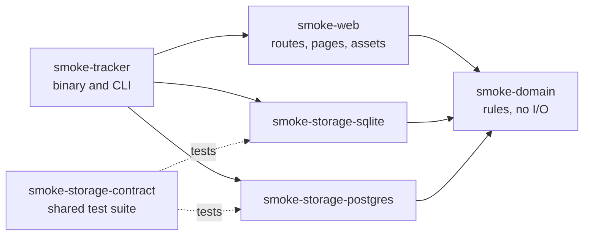
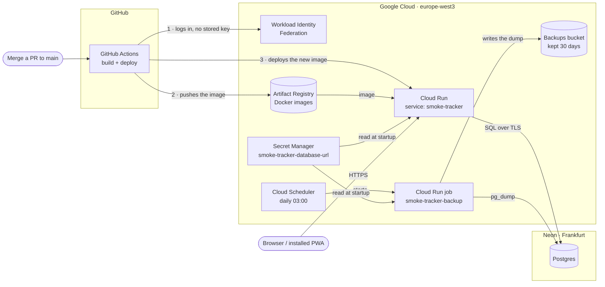

# Smoke Tracker

[](https://github.com/locadani/smoke-tracker/actions/workflows/ci.yml)
[](https://github.com/locadani/smoke-tracker/actions/workflows/security.yml)
[](https://github.com/locadani/smoke-tracker/actions/workflows/codeql.yml)

A small, installable web app (PWA) for logging cigarette smoke that drifts into an apartment
from neighbours. It records how strong the smell is, which rooms it reached, any symptoms, and
PM2.5 readings, and builds a detailed, tamper-evident record over time that can support a
formal complaint.

Written in Rust (Axum, Askama, htmx), with SQLite locally and Postgres in production. It runs
for free on Google Cloud Run and Neon.

> **Status:** in use. Every feature of the [design spec](docs/specs/2026-10-13-smoke-tracker-design.md)
> is built; see the [roadmap](docs/plans/ROADMAP.md).

## What it does

- **Log in about five seconds** from the phone's home screen: tap the rooms, give each a level
  from 0 to 10, tick any symptoms, add a PM2.5 reading or a note. **No smell** records a clean
  check with one tap.
- **Events** group the reports of one smoke incident from start to end. The app asks "Same
  smell still going?" when one is open, closes forgotten events at 04:00, and allows logging
  in the past.
- **Tamper-evident history:** every change is stored with its before and after, in an audit log
  where each entry hashes the previous one. `verify-audit` recomputes the chain and checks every
  record against it.
- **Graphs:** intensity over time with one line per person and PM2.5 as the objective
  reference, events per day or week, a room × hour-of-day heatmap, symptom frequency, and
  inside versus common areas. Filters (period, rooms or area, person, time of day, minimum
  level, hiding clean checks) live in the address, so a view can be bookmarked or shared.
- **People:** residents invite guests (who expire) and viewers (read-only, e.g. a lawyer) with
  a one-time QR code; there is no email and no self-registration.
- English, Italian and Turkish; installable on Android and iPhone; an offline page.

## How to log

Also in the app, under Settings → Guides.

| What happened | Correct action |
|---|---|
| I made a mistake (wrong number, forgot a room, wrong symptom) | Correct that report (edit; recorded in history) |
| The situation changed (stronger/weaker, a room started or stopped, symptoms started) | Add a new report to the same event |
| The smell went away completely and came back later | Start a new event |

**Rules of thumb**

1. **Never edit to show a change; add a report.** Editing changes the past; adding records the present.
2. Add a report when a room's level changes by **2 or more**, a **room starts or clears** (log it
   at 0), or a **new symptom** appears. Each report lists only the rooms you checked: a room you
   leave out is "not checked", never "clean".
3. Unsure whether it's the same event? If the smell was **completely gone** at some point, it's a new one.
4. **Close the event when the smell is gone.** Forgetting is fine (04:00 auto-close), but closing gives accurate durations.
5. **Nothing smells? Log *No smell*.** It keeps a record that you checked.

Each person rates on their own 1–10 scale. Overlapping reports with different values are kept
as-is. Graphs show one line per person; the PM2.5 reading is the objective reference.

### Intensity guide

Smell only; symptoms are recorded separately.

| Level | Name | What it's like |
|---|---|---|
| 0 | Clean | You checked: no smoke smell at all. |
| 1 | Barely there | Only if you focus. Unsure it's smoke. |
| 2 | Faint | Noticeable entering the room, then fades. |
| 3 | Light | Clearly smoke, but weak. Easy to ignore. |
| 4 | Noticeable | Constantly present, mildly annoying. |
| 5 | Moderate | Obvious all the time. You'd mention it. |
| 6 | Strong | Hard to ignore; want to open a window or leave the room. |
| 7 | Very strong | Can't stay comfortably; smell builds up. |
| 8 | Heavy | Gets into clothes/bedding; lingers after you leave. |
| 9 | Very heavy | Like standing next to someone smoking. |
| 10 | Unbearable | Like a smoke-filled room. You must leave. |

Rate what you smell right now, not how annoyed you are. Between two numbers, pick the lower.

## Who can do what

| Action | Resident | Guest (active) | Guest (expired) | Viewer |
|---|---|---|---|---|
| Log smell / PM2.5 | ✅ | ✅ | ❌ | ❌ |
| See data | all | own | own | all |
| Correct / move entries | all | own | ❌ | ❌ |
| Close / reopen events | ✅ | events they own | ❌ | ❌ |
| Invite / expire / reactivate / reset password | ✅ | ❌ | ❌ | ❌ |
| Edit room & symptom lists | ✅ | ❌ | ❌ | ❌ |
| See graphs | all data | own data | own data | all data |

- **Residents** never expire. **Guests** always have an expiry date, after which they can only
  read their own data. **Viewers** may have one, after which they cannot sign in.
- A resident can reactivate an expired account with a new expiry date; the old password still works.
- Ending someone's access signs them out everywhere.

## Architecture

A Cargo workspace of layered crates. The domain is pure Rust with no I/O; the web layer never
sees SQL, only the repository traits the domain defines; both storage backends pass one shared
test suite.



| Crate | What it holds |
|---|---|
| [`crates/domain`](crates/domain) | Types that make invalid states unrepresentable (`Level` 0–10, `Pm25`, ids), the permissions table as one function, the event rules, the logging and account use cases, the graphs' arithmetic, the hash-chained audit log, a `Clock` trait, and the repository traits |
| [`crates/storage-sqlite`](crates/storage-sqlite), [`crates/storage-postgres`](crates/storage-postgres) | The two backends: migrations kept in step (a test compares the schemas) and queries checked at compile time by `sqlx`; every write transaction appends its audit entry |
| [`crates/storage-contract`](crates/storage-contract) | One behaviour suite written against the traits and run on both backends |
| [`crates/web`](crates/web) | Axum routes (one module per screen), Askama templates, Fluent translations, and the static files compiled into the binary |
| [`crates/app`](crates/app) | The `smoke-tracker` binary: configuration from the environment, wiring, the 04:00 auto-close timer, and the CLI (`serve`, `migrate`, `create-resident`, `rename-user`, `verify-audit`) |

Some choices, each recorded with its alternatives in the [decision log](docs/DECISIONS.md):

- **Server-rendered pages** with plain forms; the little JavaScript there is (one ES module
  per behaviour: dialogs, menus, the install prompt, the charts and their filters) is
  progressive enhancement.
- **A small design system without a build step:** design tokens and cascade layers in a few
  CSS files joined at compile time, Askama macros for every repeated piece of markup, one SVG
  icon sprite; light and dark follow the phone.
- A **strict Content-Security-Policy** (`'self'` only, no inline scripts or styles): the charts
  read their data from `data-` attributes, the heatmap is a table coloured by CSS classes, and
  QR codes are inline SVG. A test scans the app's pages for anything the policy would block.
- **Server-side sessions** (revocable at once), Argon2id passwords, a sign-in rate limit, and an
  Origin check on every form post.
- All times are stored in UTC and shown in one configured time zone, so every phone shows the
  same times; tests drive the 04:00 rule across daylight-saving changes with a fake clock.

## Development

Requirements: [rustup](https://rustup.rs), [gitleaks](https://github.com/gitleaks/gitleaks)
(`brew install gitleaks`), Docker, and sqlx-cli:

```sh
git config core.hooksPath .githooks   # once per clone: blocks commits containing secrets
cargo install sqlx-cli --version 0.9.0 --no-default-features --features sqlite,postgres,rustls,sqlx-toml

# A throwaway local Postgres for the Postgres tests (no password, local only)
docker run -d --name smoke-pg -e POSTGRES_HOST_AUTH_METHOD=trust -p 5432:5432 postgres:17-alpine
export TEST_POSTGRES_URL=postgres://postgres@localhost:5432/postgres

cargo test --workspace         # Postgres tests are skipped when TEST_POSTGRES_URL is unset
scripts/sqlx-prepare.sh        # after changing a query or a migration; commit the .sqlx/ changes
cargo fmt --all --check && cargo clippy --workspace --all-targets -- -D warnings
biome ci .                     # JavaScript and CSS (the standalone Biome binary, 2.5.15)

# The accessibility check in a browser (Node 24; installs Playwright's Chromium once)
cargo build -p smoke-tracker
cd tests/e2e && npm ci && npx playwright install chromium && npx playwright test
```

Building needs no database: queries are checked against the committed `.sqlx/` metadata.

## Running it

Configuration comes from environment variables only; [`.env.example`](.env.example) lists
every one.

```sh
cp .env.example .env && mkdir -p data
set -a; . ./.env; set +a
cargo run -p smoke-tracker -- create-resident <username>   # prompts for the password
cargo run -p smoke-tracker -- serve                        # http://localhost:8080
cargo run -p smoke-tracker -- rename-user <current> <new>   # never edit usernames in the database
cargo run -p smoke-tracker -- verify-audit                 # exits with 1 if the history was altered
```

Cookies are always `Secure`, even on `http://localhost` (decision #145). Chrome and Firefox accept
that; Safari does not, so test locally in Chrome. To check Safari, serve the app over https with
[Caddy](https://caddyserver.com/docs/quick-starts/reverse-proxy), which makes a trusted
certificate for `localhost` on its first run:

```sh
caddy reverse-proxy --from localhost:8443 --to localhost:8080
APP_BASE_URL=https://localhost:8443 cargo run -p smoke-tracker -- serve   # open https://localhost:8443
```

### Container

Every push to `main` that changes the app is built, scanned and pushed to Artifact Registry by
`deploy.yml`, then deployed. The image is one static binary on a distroless base; locally the
database lives in the `/data` volume.

```sh
docker build -t smoke-tracker .
docker volume create smoke-data
docker run --rm -it -v smoke-data:/data smoke-tracker create-resident <username>
docker run -d -p 8080:8080 -v smoke-data:/data -e APP_BASE_URL=http://localhost:8080 smoke-tracker
```

On **Cloud Run** (the run.app URL or a domain mapping, no load balancer) also set
`CLIENT_IP_HEADER=X-Forwarded-For`. The app's TCP peer there is Google's front end, so
without it every visitor shares one address and the per-address sign-in limit locks
everyone out together. The front end appends the real client as the header's last entry,
which is the one the app trusts. With `RUST_LOG=info,smoke_web=debug` each sign-in attempt
logs the address it resolved, to check this on the first deploy.

## CI/CD and security

Everything runs on GitHub Actions, on free tiers, with no token stored in the repository.
Pull requests into `main` need the checks marked *required* to pass.

| Workflow | When | What |
|---|---|---|
| [`ci.yml`](.github/workflows/ci.yml) | push to `main`, pull requests | `fmt`, `clippy -D warnings`, the whole test suite on SQLite and a Postgres service (required); the committed `sqlx` query data (required); Biome on the JavaScript and CSS (required); the accessibility job (required): the app started on SQLite, seeded through its own pages, and axe-core on its pages at phone size in light and dark, with the screenshots kept for 14 days; line coverage with `cargo-llvm-cov`, shown in the job summary and kept as an `lcov` artifact |
| [`security.yml`](.github/workflows/security.yml) | push, pull requests, weekly | `cargo-deny` (RustSec advisories, licences, sources), `gitleaks`, a Trivy scan of the container image (all required) |
| [`codeql.yml`](.github/workflows/codeql.yml) | push, pull requests, weekly | CodeQL for the Rust code, the workflows and the project's own JavaScript |
| [`deploy.yml`](.github/workflows/deploy.yml) | push to `main` | Builds, scans and deploys the image to Cloud Run |
| [`infra.yml`](.github/workflows/infra.yml) | changes under `infra/` | Terraform format, validation, tests and plan |

Dependabot keeps Cargo crates, actions, Docker images and Terraform providers up to date; a
gitleaks pre-commit hook and GitHub push protection stop secrets before they leave a laptop.

## Hosting

The app runs on Google Cloud Run, with its data in a Neon Postgres database. Both are on free
tiers, in Frankfurt. SQLite is used for local development and tests. Every merge to `main` that
changes the app is deployed by `deploy.yml`, and the database is dumped to a bucket every night.



| Piece | What it does | Where secrets live |
|---|---|---|
| GitHub Actions | Builds the Docker image and deploys it on every push to `main` that changes the app (changes only to `docs/`, `*.md` or `infra/` don't deploy) | None. Project and account identifiers are stored as GitHub secrets only so they are masked in public logs |
| Workload Identity Federation | Lets this repository's workflows act as narrowly-scoped service accounts (`smoke-tracker-deploy` for deploys, `terraform-plan` for read-only plans), with short-lived tokens instead of a stored key | — |
| Artifact Registry | Stores the Docker images (repository `smoke-tracker`); a cleanup policy deletes old images and keeps the latest 3 | — |
| Cloud Run | Runs the app as the `smoke-tracker-run` service account. Scales to zero when idle and allows at most one instance | — |
| Secret Manager | Holds the database connection string; only `smoke-tracker-run` can read it. The app sees it as `DATABASE_URL` | `smoke-tracker-database-url` |
| Cloud Scheduler, backup job, backups bucket | Every night at 03:00 (Europe/Berlin) a Cloud Run job runs `pg_dump` and writes the dump to a bucket in the same region; dumps are deleted after 30 days. See [`infra/`](infra/README.md#backups) | — |
| Neon | Postgres database. Pauses after 5 minutes idle and keeps 6 hours of restore history; the nightly backup covers older mistakes | The database password |

No secret is ever stored in this repository, in a Docker image, or in GitHub.

The Google Cloud side is Terraform: see [`infra/`](infra/README.md) for what is automatic, what is
manual and why, and how changes are applied.

## Third-party code in the binary

Two JavaScript libraries are vendored byte for byte under `crates/web/static/`; a test pins
each file's SHA-256 to the published release.

| Library | Version | Licence | Used for |
|---|---|---|---|
| [htmx](https://htmx.org) | 2.0.11 | 0BSD | Loaded on every page |
| [Chart.js](https://www.chartjs.org) | 4.5.1 | MIT | The Graphs screen |

## Documentation

- [Design spec](docs/specs/2026-10-13-smoke-tracker-design.md) and
  [hosting spec](docs/specs/2026-10-13-hosting-infra-design.md)
- [Decision log](docs/DECISIONS.md): every product and technical decision, with the alternatives
- [Roadmap](docs/plans/ROADMAP.md) and the plan of each milestone
- [Infrastructure](infra/README.md)

## Licence

[MIT](LICENSE)
