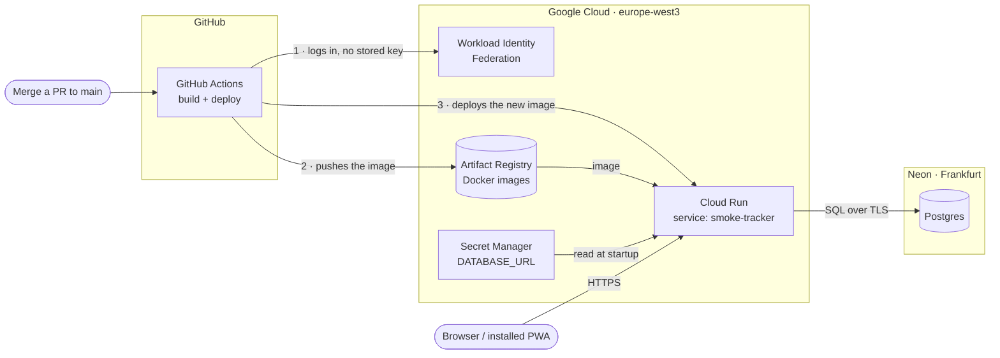

# Smoke Tracker

A small, installable web app (PWA) for logging cigarette smoke that drifts into an apartment
from neighbours. It records how strong the smell is, which rooms it reached, any symptoms, and
PM2.5 readings, and builds a detailed, tamper-evident record over time.

Written in Rust (Axum, Askama, htmx), with SQLite locally and Postgres in production.

> **Status:** early development. See the [roadmap](docs/plans/ROADMAP.md).

## Development

Requirements: [rustup](https://rustup.rs), [gitleaks](https://github.com/gitleaks/gitleaks)
(`brew install gitleaks`), Docker, and sqlx-cli:

```sh
git config core.hooksPath .githooks   # once per clone: blocks commits containing secrets
cargo install sqlx-cli --version 0.9.0 --no-default-features --features sqlite,postgres,rustls,sqlx-toml

# A throwaway local Postgres for the Postgres tests (no password, local only)
docker run -d --name smoke-pg -e POSTGRES_HOST_AUTH_METHOD=trust -p 5432:5432 postgres:17-alpine
export TEST_POSTGRES_URL=postgres://postgres@localhost:5432/postgres

cargo test --workspace         # Postgres tests are skipped when TEST_POSTGRES_URL is unset
scripts/sqlx-prepare.sh        # after changing a query or a migration; commit the .sqlx/ changes
```

Building needs no database: queries are checked against the committed `.sqlx/` metadata.

## Hosting

The app runs on Google Cloud Run, with its data in a Neon Postgres database. Both are on free
tiers, in Frankfurt. SQLite is used for local development and tests. The deploy workflow is
added after milestone 3.



| Piece | What it does | Where secrets live |
|---|---|---|
| GitHub Actions | Builds the Docker image and deploys it on every merge to `main` | None. Only non-secret IDs, as repository variables: `GCP_PROJECT_ID`, `GCP_REGION`, `GCP_WIF_PROVIDER`, `GCP_DEPLOY_SA` |
| Workload Identity Federation | Lets this repository's workflows act as the `github-deploy` service account, with short-lived tokens instead of a stored key | — |
| Artifact Registry | Stores the Docker images (repository `smoke-tracker`, keeps the latest 3) | — |
| Cloud Run | Runs the app as the `smoke-run` service account. Scales to zero when idle and allows at most one instance | — |
| Secret Manager | Holds the database connection string; only `smoke-run` can read it | `DATABASE_URL` |
| Neon | Postgres database. Pauses after 5 minutes idle and keeps 6 hours of restore history, so a daily backup job (planned) will cover older mistakes | The database password |

No secret is ever stored in this repository, in a Docker image, or in GitHub.

## Documentation

- [Design spec](docs/specs/2026-10-13-smoke-tracker-design.md)
- [Decision log](docs/DECISIONS.md)
